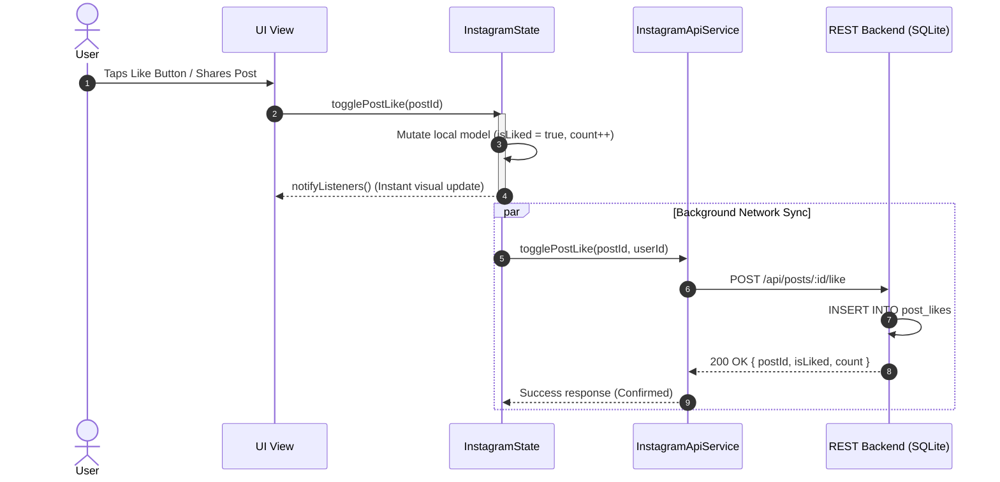
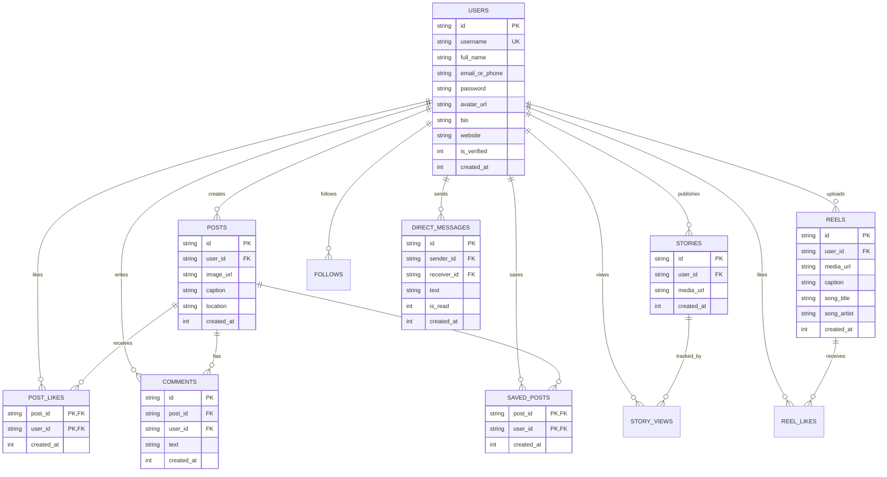

# 📐 System Design & Architecture Document

## 1. Executive Summary

The **Flutter Instagram Clone** is architected as an offline-capable, responsive full-stack mobile client backed by a lightweight, high-performance Node.js REST API and SQLite database engine. The system is designed to replicate Instagram's exact user experience: fluid 60fps micro-animations, instant optimistic UI updates, resilient network fallbacks, and authentic visual hierarchy.

---

## 2. High-Level Architecture

The application adopts a **Clean Service-Repository Architecture** on the Flutter client, paired with a modular **Controller-Database Architecture** on the server.

```mermaid
graph TD
    subgraph "Flutter Client (Mobile / Web / Desktop)"
        UI["UI Layer<br/>(Screens & Custom Widgets)"]
        State["State Layer<br/>(InstagramScope + InstagramState)"]
        Service["Service Layer<br/>(InstagramApiService + ApiClient)"]
        Cache["Local Cache<br/>(SharedPreferences)"]
        
        UI -->|Events & User Actions| State
        State -->|Rebuild Notifications| UI
        State -->|Optimistic Updates| UI
        State -->|Async API Calls| Service
        Service -->|Persist Session| Cache
        Cache -->|Restore Session| State
    end

    subgraph "REST API Backend (Node.js)"
        Router["Express Router & Controllers<br/>(server/index.js)"]
        DB["SQLite Storage Engine<br/>(node:sqlite DatabaseSync)"]
        
        Service -->|HTTP REST Requests (JSON)| Router
        Router -->|Synchronous Fast Queries (WAL)| DB
        DB -->|Query Results| Router
        Router -->|JSON Responses| Service
    end
```

---

## 3. UI/UX Design System & Tokens

### 3.1 Color Palette & Tokens
| Token | Value | Usage |
|---|---|---|
| **Primary Brand Blue** | `#0095F6` | Primary action buttons, verified badge, active links |
| **Scaffold Background** | `#FFFFFF` | Standard daylight theme background |
| **Reels Background** | `#000000` | Fullscreen immersive dark mode |
| **Border / Divider** | `#EFEFEF` / `#DBDBDB` | Tab bars, input borders, item separators |
| **Text Primary** | `#262626` / `Colors.black87` | Headlines, usernames, primary body copy |
| **Text Secondary** | `#8E8E8E` / `Colors.grey` | Timestamps, subtitles, placeholder hints |
| **Like Red** | `#ED4956` | Active heart icon color |

### 3.2 Story Gradient Palette
The iconic Instagram story ring gradient is applied using a 3-stop `LinearGradient`:
```dart
const LinearGradient(
  colors: [
    Color(0xFFFBAA47), // Sunset Orange
    Color(0xFFD91A46), // Magenta Red
    Color(0xFFA60F93), // Royal Violet
  ],
  begin: Alignment.bottomLeft,
  end: Alignment.topRight,
)
```

### 3.3 Typography
- **Brand Wordmark:** Authentic *Billabong* cursive script for the top-bar Instagram logo.
- **System Interface:** Clean, legible Roboto / system sans-serif with strict weight hierarchy:
  - **Bold (`w700`):** Usernames, action buttons, numerical stats.
  - **Medium (`w500`):** Filter chips, tab labels.
  - **Regular (`w400`):** Post captions, comments, time-ago labels.

---

## 4. State Management: The Optimistic UI Pattern

To guarantee Instagram's signature **instantaneous feel**, state changes do not block on network roundtrips.



### Benefits of this Pattern:
1. **Zero Perceived Latency:** Buttons react within 1 frame (<16ms) without progress spinners.
2. **Offline Resilience:** If the network is momentarily down or the server is starting up, user interactions are preserved in-memory and reflected immediately.
3. **Session Rehydration:** When the app launches, `SharedPreferences` immediately restores user identity while background sync refreshes feed posts, stories, reels, and unread badges.

---

## 5. Database Schema & Entity Relationships

The backend uses a normalized SQLite database with foreign keys enabled (`PRAGMA foreign_keys = ON;`) and Write-Ahead Logging (`PRAGMA journal_mode = WAL;`) for maximum concurrency.



---

## 6. REST API Specification

| Method | Endpoint | Description | Request Payload / Params |
|---|---|---|---|
| `GET` | `/api/health` | Service health check | None |
| `POST` | `/api/auth/register` | Register new account | `{ username, fullName, emailOrPhone, password, avatarUrl }` |
| `POST` | `/api/auth/login` | Log into account | `{ usernameOrEmail, password }` |
| `GET` | `/api/auth/me` | Fetch user profile & stats | `?userId={id}` |
| `PUT` | `/api/auth/profile` | Update profile fields | `{ userId, bio, website, fullName, avatarUrl }` |
| `GET` | `/api/posts` | Feed posts with author & likes | `?userId={currentUserId}` |
| `POST` | `/api/posts` | Create new photo post | `{ userId, imageUrl, caption, location }` |
| `POST` | `/api/posts/:id/like` | Toggle like status | `{ userId }` |
| `POST` | `/api/posts/:id/save` | Bookmark post | `{ userId }` |
| `POST` | `/api/posts/:id/comments` | Add comment to post | `{ userId, text }` |
| `GET` | `/api/posts/saved` | List bookmarked posts | `?userId={id}` |
| `GET` | `/api/stories` | Active stories (<24h) | `?currentUserId={id}` |
| `POST` | `/api/stories` | Add photo to story | `{ userId, mediaUrl }` |
| `POST` | `/api/stories/:id/view`| Mark story viewed | `{ userId }` |
| `GET` | `/api/reels` | List vertical reels | `?userId={id}` |
| `POST` | `/api/reels/:id/like` | Toggle like on reel | `{ userId }` |
| `GET` | `/api/messages/threads`| List chat inbox threads | `?userId={id}` |
| `POST` | `/api/messages` | Send direct message | `{ senderId, receiverId, text }` |
| `GET` | `/api/explore` | Explore media grid | None |
| `GET` | `/api/users/search` | Search accounts | `?q={query}&userId={id}` |
| `POST` | `/api/users/:id/follow`| Follow/unfollow user | `{ currentUserId }` |

---

## 7. Resilience & Graceful Degradation Strategy

1. **Avatar & Image Fallbacks:**
   - If `avatarUrl` is empty or fails to load, `CircleAvatar` falls back to the user's capitalized first initial with soft neutral background.
   - If an image link fails to load, `errorBuilder` displays an elegant icon placeholder rather than an unhandled red screen exception.
2. **Empty State Architecture:**
   - Every tab (Feed, Posts, Reels, Saved, Tagged, Explore) defines an authentic empty state that explains the section and provides a clear call-to-action (e.g. *"Share your first photo"*).
3. **Network Timeout Guard:**
   - All network requests in `ApiClient` are bound to a strict 8-second timeout, preventing stuck UI loaders.
4. **Platform Host Resolution:**
   - `ApiConfig` resolves host URLs automatically for Android USB debugging (`localhost:5000` via `adb reverse`), Android Emulators (`10.0.2.2:5000`), and Desktop/Web.

---

## 8. Verification & Test Strategy

The project implements a multi-tiered verification pipeline:
- **Unit & Serialization Tests ([test/backend_api_test.dart](file:///c:/Users/Deekshith%20Raj%20Basa/Documents/GitHub/Flutter_instagram_clone/test/backend_api_test.dart)):** Validates bidirectional JSON serialization across all data models and verifies API route constants.
- **Widget Smoke Tests ([test/widget_test.dart](file:///c:/Users/Deekshith%20Raj%20Basa/Documents/GitHub/Flutter_instagram_clone/test/widget_test.dart)):** Validates the onboarding pipeline, login transitions, and main navigation coordination with mock HTTP overrides.
- **Static Analysis:** Verified with `flutter analyze` (0 errors, 0 warnings).
- **Release Compilation:** Verified with Android Gradle assemble build producing `app-debug.apk`.
